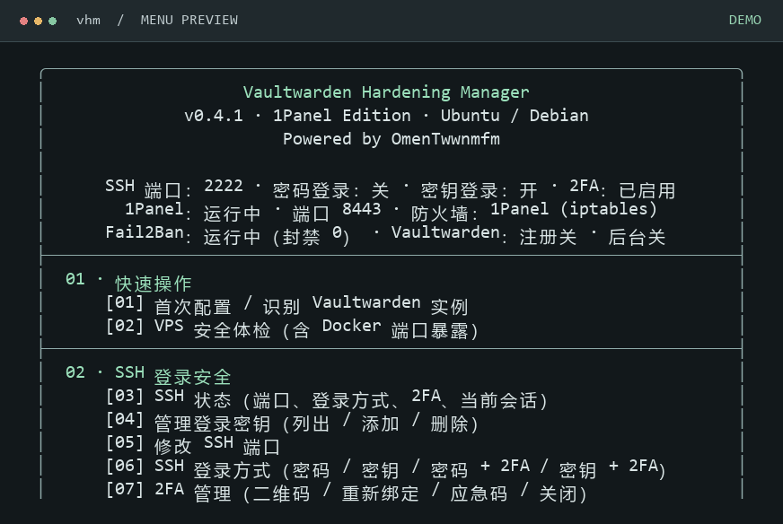

<div align="center">

# Vaultwarden Hardening Manager

**VPS 安全体检 · 分用户 SSH 登录 · 防火墙与 Fail2Ban · Vaultwarden 管理**

面向在 Ubuntu / Debian 上用 1Panel 部署 Vaultwarden 的管理员


[快速开始](#快速开始) · [主菜单预览](#主菜单预览) · [使用手册](docs/使用手册.md) · [更新日志](CHANGELOG.md)

</div>

---

## 项目简介

`vhm` 用来加固已运行的 Vaultwarden 和它所在的 VPS。先做一次只读体检，看看哪些端口对外开放、SSH 怎么验证登录、Fail2Ban 是否运行，再按结果调整 SSH、防火墙和 Vaultwarden 设置。改 SSH 端口或登录方式时，向导会先备份配置并启用自动回滚保护。

1Panel 继续负责部署、域名、HTTPS 和反向代理；`vhm` 负责安全加固；兄弟项目 [vaultwarden-backup-manager](https://github.com/OmenTwwnmfm/vaultwarden-backup-manager)（`vbm`）负责备份与恢复。安装了 `vbm` 时，`vhm` 在修改 Vaultwarden 设置之前会先调用它备份。

**当前版本：[`v0.5.1`](https://github.com/OmenTwwnmfm/vaultwarden-hardening-manager/releases/tag/v0.5.1)。** 启动和 `[27]` 检查源码更新时，先显示当前版本、目标版本和更新内容，输入 `yes` 才更新。历次变更见[更新日志](CHANGELOG.md)。

## 快速开始

在 VPS 的 SSH 终端执行：

```bash
sudo git clone https://github.com/OmenTwwnmfm/vaultwarden-hardening-manager /opt/vaultwarden-hardening-manager
cd /opt/vaultwarden-hardening-manager
sudo bash ./run.sh
```

1. **首次配置：** 选 `[01]` 检查依赖并识别 Vaultwarden 实例。
2. **做一次体检：** 选 `[02]`，或在终端运行 `sudo vhm checkup`。这一步是只读的，也可以在首次配置前运行。
3. **按结果处理：** 优先看「危险」项，再选择 `[06]` 配置 SSH、`[15]` 管理防火墙或 `[16]` 启用 Fail2Ban。Vaultwarden 注册、后台及安全选项见 `[19]`、`[20]`、`[22]`。完整顺序见[快速开始指南](docs/快速开始.md)。

> **修改 SSH 前先打开 VPS 服务商的 VNC 控制台，并保留当前 SSH 会话。** 修改后用新连接验证成功，再回原窗口确认。

以后在任意目录运行 `sudo vhm` 即可打开菜单。已有安装仍使用旧仓址时，参见[仓库改名后的升级步骤](docs/使用手册.md#仓库改名后的升级)。

## 主菜单预览



上图是旧版演示环境的菜单局部截图。当前菜单分为以下八类：

| 分类 | 菜单 |
|---|---|
| 01 · 快速操作 | `[01]` 首次配置 / 识别 Vaultwarden 实例　`[02]` VPS 安全体检 |
| 02 · SSH 登录安全 | `[03]` SSH 状态　`[04]` 管理登录密钥　`[05]` 修改 SSH 端口　`[06]` 登录方式　`[07]` 2FA 管理　`[08]` 登录记录 |
| 03 · 1Panel 面板 | `[09]` 面板状态 `[10]` 修改面板端口 `[11]` 修改用户名 / 密码 `[12]` 切换监听地址 `[13]` 启动 / 停止 / 重启 `[14]` 应急重置 |
| 04 · 防火墙 | `[15]` 规则列表 / 添加 / 删除（1Panel iptables 与 UFW） |
| 05 · Fail2Ban | `[16]` 安装 / 修改 SSH 防护配置　`[17]` 状态、封禁列表、解封 IP |
| 06 · Vaultwarden | `[18]` 状态总览　`[19]` 开启 / 关闭注册　`[20]` 后台 ADMIN　`[21]` 用户列表　`[22]` 安全选项 |
| 07 · 系统加固 | `[23]` 自动安全更新　`[24]` 内核网络参数加固 |
| 08 · 系统维护 | `[25]` 变更记录与回滚　`[26]` 生成脱敏诊断报告　`[27]` 检查 / 更新项目源码 |

## 适用环境与边界

| 项目 | 说明 |
|---|---|
| 系统 | Ubuntu / Debian，使用 systemd 管理服务与回滚保护 |
| 权限 | root 或可使用 `sudo` 的账号；项目目录需由 root 所有、普通用户不可写 |
| Vaultwarden | 主要面向 1Panel 应用商店的 Docker 部署；通过容器 `/data` 挂载识别实例，用户列表读取 SQLite |
| 1Panel 和防火墙 | 面板管理通过 1Panel v2 的 `1pctl`；`[15]` 支持 1Panel 的 iptables 规则和 UFW |

没有识别到 Vaultwarden 实例时，仍可使用 SSH、防火墙、Fail2Ban 与系统体检。修改范围与恢复方式见[安全与影响说明](docs/安全与影响说明.md)。

## 操作确认输入

需要确认的操作会先显示改动内容。输入 `yes`、`YES` 或 `Yes` 均可继续；其他输入取消。体检、状态和登录记录等只读操作不需要确认。

## 功能特点

### VPS 安全体检

`[02]` 一次检查整台 VPS，结果按 **正常 / 注意 / 危险** 标出，每项附一句处理建议：

- **端口与防火墙**：识别 1Panel 管理的防火墙（iptables / nftables）以及 ufw、firewalld；列出哪些端口对所有 IP 开放、哪些只对指定 IP 放行。体检本身只读，规则在 1Panel 或 `[15]` 中修改。
- **Docker 绕过防火墙**：容器端口发布在 `0.0.0.0` 时，外网可以绕过 OpenResty 和主机防火墙直接访问。体检会标红并实测访问；检测到 1Panel v2 的 Docker 端口访问控制时降为提示。
- **SSH**：端口、密码登录、2FA、`authorized_keys` 权限、系统时间同步。
- **Fail2Ban**：是否安装、运行、有 sshd 防护，当前封禁多少 IP。
- **系统**：root 以外 UID 为 0 的账户、sudo 用户、自动安全更新、内核网络参数、是否需要重启。
- **1Panel**：面板服务、面板端口是否对所有 IP 放行、是否为默认端口、安全入口、面板 HTTPS。
- **Vaultwarden**：开放注册、后台状态与令牌类型、`DOMAIN` 是否 https、数据目录权限、vbm 最近一次备份结果。

体检只做本机检查，无法证明公网实际可达性；云服务器还要核对服务商的安全组。

### 防火墙管理与同步

- [15] 检测当前后端并写入同一个规则体系。1Panel iptables 模式更新 1PANEL_BASIC 链并写入 1Panel 启动时读取的 firewall rules 文件；UFW 模式通过 ufw 命令写入其持久规则。
- 规则包含动作、地址族、TCP/UDP、端口和来源 IPv4/IPv6/CIDR。规则立即生效并显示在 1Panel 防火墙页面，重启后仍保留。
- 可在 `[25]` 撤销规则改动。UFW 无法确认删除规则的原位置时会停止并提示人工处理，详见[使用手册](docs/使用手册.md#5-防火墙与-docker)。

### SSH 登录方式与 2FA

- [06] 先选择 root 或一个已有的普通本地用户，再为该用户选择密码登录（不建议）、密钥登录、密码 + 动态口令、密钥 + 动态口令。每个用户独立配置，其他用户保留原认证方式；也可通过系统 `passwd` 修改所选账户密码。
- 普通用户子菜单的 `[6]` 是可选的管理员方案：SSH 必须通过公钥、账户密码和 TOTP；新会话中验证 `sudo` 可用后才关闭 root SSH，再用最终配置建立新连接确认。它要求用户已有标准 sudo 管理授权，不自动创建用户或扩大权限。
- 该方案的每次新 sudo 提权调用都重新验证账户密码和 TOTP，`timestamp_timeout=0` 关闭缓存。已打开的 root shell、root 权限程序和 vhm 菜单内的操作不会逐条重新认证；需要每条命令都受控时，还需单独设计 sudo 命令授权范围。
- 使用 `libpam-google-authenticator`，支持 Google Authenticator、Microsoft Authenticator、2FAS 等任意 TOTP 验证器。
- 不使用 `nullok`：没有绑定动态口令就无法登录，不留「没绑定就跳过」的后门。
- 绑定时在终端显示二维码（同时给出可手动输入的密钥和 `otpauth://` 链接），先校验一次动态口令，再显示 5 个一次性应急码。
- `[07]` 按用户显示二维码、重新绑定或查看应急码。普通模式可关闭 2FA 并切换为密钥登录；管理员方案通过 `[25]` 回滚整次迁移来退出，避免遗留无法登录或提权的配置。
- 普通管理员的 SSH 与 sudo 共用其独立的 TOTP 绑定，保留验证码防重放；登录后紧接 sudo 时，请等验证器的下一组验证码。公钥和种子由 root 集中管理，不复用 root 的种子。
- 自动配置只接受可确认的 Debian / Ubuntu PAM 和 SSH 配置；自定义 Match、复杂 sudoers、NOPASSWD 或外部授权源会被拒绝，并提示人工审核。1Panel 网页终端须支持所选认证组合，容器终端不受影响。

### 防锁死保护

修改端口、启用或关闭 2FA、重新绑定动态口令时：

1. 先保存原配置，再启用 systemd 定时器和开机回滚服务；保护启用失败时取消修改。
2. 写入配置后执行 `sshd -t`，用 `sshd -T` 核对生效值，再重载 SSH（兼容 Ubuntu 22.10+ 的 `ssh.socket`）。
3. 保持当前会话，另开窗口按新方式登录，成功后回来输入 `yes`。确认状态保存后才停止定时器。
4. 输入其他内容会立即尝试回滚；超时或管理器被中断时，定时器会接手。

保护期内机器意外重启时，开机回滚服务 `vhm-guard-boot.service` 会把仍未确认的修改改回来。

修改端口时先同时监听新旧端口，确认新端口能登录后再关闭旧端口。Fail2Ban 通过 systemd 配置监视器（`sshd_config` 与整个 `sshd_config.d` 目录）和 5 分钟周期核对自动同步 sshd jail 端口。

### Fail2Ban

- 未安装时自动安装；配置失败次数、统计时间窗口、封禁时长和白名单（默认填入当前连接 IP）。
- 配置写入独立的 `/etc/fail2ban/jail.d/vhm-sshd.local`，不修改系统自带文件；SSH 端口与日志后端（auth.log / systemd journal）自动识别。
- 配置先经 `fail2ban-client -t` 检查，启动失败自动恢复原配置。
- `[17]` 查看状态与封禁列表，输入 IP 即可解封。

### 1Panel 面板

全部通过 1Panel 自带的 `1pctl` 完成（按 1Panel v2 实现），vhm 不直接修改 1Panel 数据库。

- **面板状态**：版本、服务状态、面板端口、安全入口（只显示前两位）、访问协议、监听方式，以及面板端口在防火墙中是否对所有 IP 放行。
- **修改面板端口**：先检查新端口未被占用、已在 1Panel 防火墙中放行，修改后等待面板在新端口启动；失败自动改回，也可在 `[25]` 回滚。
- **修改用户名 / 密码**：可先生成一个 20 位随机密码供粘贴，再由 `1pctl` 交互输入。不保存旧值，因此不能回滚。
- **切换监听地址**：只监听 IPv4，或监听 IPv6（同时接受 IPv4）。可回滚。
- **启动 / 停止 / 重启**：兼容 v2 的 `1panel-core` / `1panel-agent` 两个服务。
- **应急重置**：被面板挡在外面时自救，可取消安全入口、授权 IP、域名绑定、面板 HTTPS、两步验证或通行密钥。只列出当前版本 `1pctl reset` 支持的项目；必须输入项目名确认，且不能回滚，恢复访问后请立即在面板中重新设置。
- 不提供卸载和数据恢复，误操作代价太大。

### Vaultwarden 管理

- **开放注册 / 邀请注册**：分别开关。
- **后台 ADMIN**：开启时自动生成随机密码（只显示一次）或自己输入，`config.json` 中只保存 argon2id 哈希；不用时可一键关闭。
- **用户列表**：邮箱、注册时间、最近活动、是否开启两步验证、是否被禁用。只读打开 SQLite，不修改数据库。
- **安全选项**：密码提示、登录页显示提示、Send、紧急访问、可创建组织的用户、图标服务，支持一键推荐设置。
- 设置写入数据目录的 `config.json`，与在 `/admin` 页面保存的效果相同。它优先于 1Panel 应用参数，且 1Panel 升级或重建应用时不会被覆盖。`[18]` 显示每项的实际生效值和来源。

### 修改前自动备份

每次修改 Vaultwarden 设置：

1. 先调用 vbm 做一次完整备份（Vaultwarden 会短暂停止）。本地校验、服务恢复、远端核验全部通过才继续；vbm 正在执行定时备份时直接放弃，不会修改。
2. 修改期间持有 vbm 的锁，避免定时备份在重启容器时介入。
3. 保存原 `config.json` → 原子写入（权限 `600`）→ 重启容器 → 等待健康检查（最长 120 秒）。
4. 健康检查失败自动恢复原 `config.json` 并再次重启。

未安装 vbm 时会额外要求确认，并仍保存修改前的 `config.json` 供回滚。

### 系统加固

- **自动安全更新**：安装并启用 `unattended-upgrades`。只装系统安全更新，不升级容器和 1Panel 应用，不自动重启。
- **内核网络参数**：开启 SYN cookies，拒绝 ICMP 重定向与源路由，开启反向路径过滤（宽松模式，兼容 Docker），忽略广播 ping。写入 `/etc/sysctl.d/90-vhm-hardening.conf`，不修改 `ip_forward`。

### 变更记录与回滚

- 每次修改前保存涉及的原文件、权限和属主，记录在 `/var/lib/vaultwarden-hardening/changes/`。
- `[25]` 列出最近 30 条变更和占用空间，可按条回滚；回滚后自动重新加载 SSH、Fail2Ban、内核参数、1Panel 面板设置、防火墙规则或重启 Vaultwarden。
- 可删除指定记录（支持 `3 5 8-12` 这样的多选和范围）、一键删除已回滚的记录，或只保留最近 N 条。
- 自动清理：保留最近 50 条以及 90 天内的全部记录，更早的在下次修改时自动删除。防锁死保护中的记录不会被删除。
- 修改操作互斥，同时只能有一个在运行；冲突时以退出码 `75` 明确跳过。

### 全局快捷命令

- 每次通过 `sudo bash ./run.sh` 启动时，都会自动安装或修复 `/usr/local/bin/vhm`。
- 之后在任意目录执行 `sudo vhm` 即可进入菜单。
- 启动菜单时，vhm 默认检查官方仓库的 `main` 分支。发现可更新的源码时，先显示当前版本、目标版本及目标提交新增的更新日志；没有新增日志时显示提交摘要。输入 `yes` 才更新并重新加载菜单，未确认时保留当前源码。
- `/etc/vaultwarden-hardening.conf` 中的 `AUTO_UPDATE="notify"`（默认）在启动时检查并询问，旧值 `"apply"` 也按 `notify` 处理。`AUTO_UPDATE="off"` 只跳过启动检查，仍可在 `[27]` 手动检查、预览并确认。本地已跟踪文件有改动、当前不在 `main` 或网络不可用时会保留当前版本。
- 从 v0.5.0 升级时，只有明确设置了 `AUTO_UPDATE="apply"` 才需要在启动前改成 `"notify"`，让这次升级也先询问。没有配置文件时直接使用默认设置。
- `vhm` 指向当初克隆的项目目录。移动项目目录后，在新位置重新运行一次 `sudo bash ./run.sh`，进入菜单时会自动把 vhm 的 systemd 单元改到新位置。

## 文件与路径

| 用途 | 路径 |
|---|---|
| 配置（实例） | `/etc/vaultwarden-hardening.conf`（`600`） |
| 变更记录 | `/var/lib/vaultwarden-hardening/changes/` |
| 日志（已脱敏） | `/var/log/vaultwarden-hardening.log` |
| SSH 配置 | `/etc/ssh/sshd_config` 中的分用户规则，及 `/etc/ssh/sshd_config.d/00-vhm.conf` 的全局设置 |
| 分用户公钥 | `/etc/ssh/vhm-authorized-keys/<用户>` |
| 分用户 TOTP | `/etc/security/vhm-access/<用户>/totp`（`600`）；旧 root 绑定使用 `/root/.google_authenticator` |
| Fail2Ban | `/etc/fail2ban/jail.d/vhm-sshd.local` |
| 后台服务 | `/etc/systemd/system/vhm-ssh-port-sync.{service,path,timer}`、`vhm-guard-boot.service` |
| 日志轮转 | `/etc/logrotate.d/vaultwarden-hardening` |
| 内核参数 | `/etc/sysctl.d/90-vhm-hardening.conf` |
| Vaultwarden 设置 | `<数据目录>/config.json` |

## 命令行

`sudo vhm` 进入交互菜单。只读子命令：`checkup`、`ports`、`ssh-status`、`vw-status`、`vw-users`、`changes`、`diagnose`、`deps`、`version`；`rollback <变更ID>` 回滚一条变更。修改操作只在菜单中提供。

退出码：`0` 成功 · `1` 失败或取消 · `2` 实例无法确定 · `75` 另一个修改操作正在运行。

## 常见问题

**启用 2FA 后登录被拒怎么办？** 先确认系统时间已同步，再尝试用应急码登录。仍不行就在保护时间内什么都不做，等待自动回滚；或通过 VNC 登录，用 `vhm changes` 查看变更 ID 后执行 `vhm rollback <变更ID>`。

**为什么 root 选「密钥 + TOTP」后 `PermitRootLogin` 是 `yes`？** OpenSSH 的 `prohibit-password` 也会禁止 root 通过键盘交互输入动态口令。这个模式用 `AuthenticationMethods` 强制先过密钥、再过 TOTP，并关闭 SSH 密码认证。切回 root 的纯密钥模式会使用 `prohibit-password`；给普通用户设置 TOTP 不会改变 root 的登录规则。

**1Panel「SSH 管理」显示的值和实际不一致？** `[06]` 按用户设置 SSH 登录方式，面板显示的全局值不一定适用于某个用户。通过 `[03]` 查看已配置的账号和对应模式，修改后再用新连接验证。

**1Panel 的网页「终端」用不了了？** 它通过 SSH 连接本机。所用账号启用 TOTP 后，网页终端也必须支持该认证组合。1Panel 的「容器终端」不走 SSH，不受影响。

**改了 1Panel 应用参数却不生效？** `config.json` 中的同名设置优先。用 `[18]` 查看每项的来源，在 vhm 中修改即可。

**防火墙里关了端口，外网还能访问 Vaultwarden？** Docker 发布的端口会绕过 ufw / firewalld。在 1Panel →「已安装应用」→ Vaultwarden →「参数」中取消「端口外部访问」，让容器只监听 `127.0.0.1`。

**提示「发现多个候选实例」？** 在 `/etc/vaultwarden-hardening.conf` 中填写 `VW_DATA_DIR`（容器 `/data` 对应的主机路径），再运行 `[01]`。

## 安全声明

- 修改 SSH 前请确认能通过服务商控制台的 VNC 登录。
- 2FA 应急码请离线保存；手机丢失且应急码用完时，只能通过 VNC 恢复。
- 后台 ADMIN 密码只显示一次，请立即保存到密码管理器；不用后台时建议关闭，或在 1Panel 反向代理中限制 `/admin` 的来源 IP。
- 管理器需要从 root 所有且普通用户不可修改的目录运行；推荐按快速开始安装到 `/opt`。
- 诊断报告和日志只输出配置项名称、状态和路径，不输出令牌、哈希、密码等秘密值。
- 本项目不构成安全审计或安全保证，请自行评估风险。

## 贡献

欢迎提交 Issue 或 Pull Request。涉及 SSH、PAM、防火墙和容器启停的修改，请同时提供 shellcheck 结果、测试结果，以及防锁死和回滚路径的说明。不要在 Issue 中上传真实配置、应急码、令牌或未脱敏的日志；需要环境信息时请贴 `[26]` 的脱敏诊断报告。

## 开发与测试

CI 在每次推送和 Pull Request 时运行 ShellCheck、Bash 语法检查、全部测试、发布策略检查和密钥扫描。可以在 Debian / Ubuntu 下运行同样的脚本检查：

```bash
shellcheck -x run.sh scripts/*.sh scripts/lib/*.sh tests/*.sh tests/integration/*.sh
bash tests/check.sh
```

提交涉及 SSH、PAM、防火墙和容器启停的修改前，请先在本地跑通全部测试，并说明防锁死与回滚路径。

## 文档

- [快速开始](docs/快速开始.md)
- [使用手册](docs/使用手册.md)
- [安全与影响说明](docs/安全与影响说明.md)
- [路线图](ROADMAP.md)
- [更新日志](CHANGELOG.md)

## License

MIT License。详见仓库中的 `LICENSE`。
